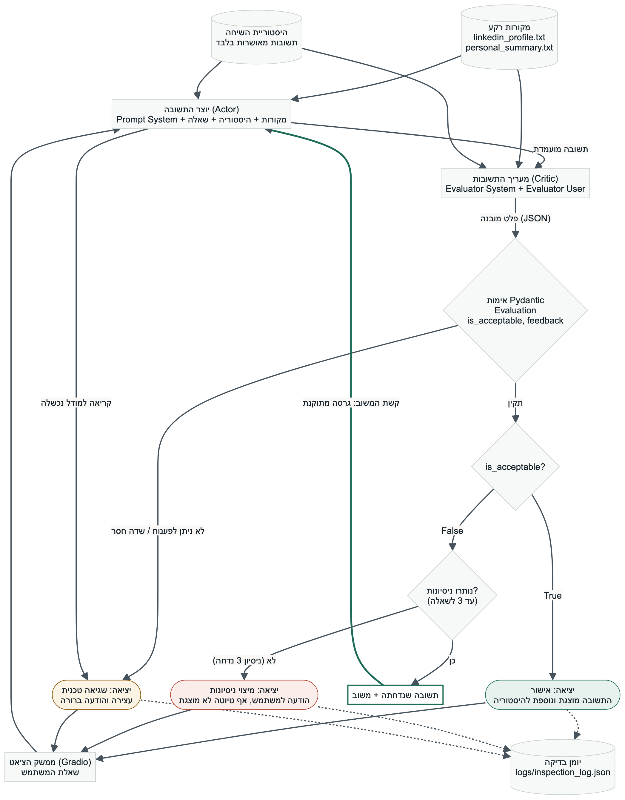

# מטלה 1: מערכות בינה מלאכותית, צ׳אט אישי עם מעריך תשובות

הפרויקט מממש את **חלק א׳** (מידע רקע ויוצר התשובה), **חלק ב׳** (מעריך תשובות ופלט מובנה), **חלק ג׳** (לולאת יצירה, הערכה ותיקון) ו**חלק ד׳** (ניסויים ותוצאות) של המטלה.

## זרימת הטיפול בשאלה (לולאת יצירה, הערכה ותיקון)

לכל שאלת משתמש יש לכל היותר **3 ניסיונות יצירה**, כולל התשובה הראשונה. כל תשובה חדשה נבדקת מחדש על ידי המעריך.

1. **יצירה:** יוצר התשובה (Actor) מקבל את מקורות הרקע (בהודעת המערכת), את היסטוריית השיחה ואת השאלה, ומפיק תשובה מועמדת.
2. **הערכה:** מעריך התשובות (Critic) מקבל את השאלה, התשובה המועמדת, היסטוריית השיחה ושני מקורות הרקע. הפלט המובנה מאומת מול מודל `Evaluation`, וההחלטה נשענת רק על השדה הבוליאני `is_acceptable` לאחר האימות.
3. **אישור** (`is_acceptable=True`): התשובה מוצגת, נוספת להיסטוריה, והטיפול בשאלה מסתיים.
4. **דחייה ותיקון** (`is_acceptable=False` ונותרו ניסיונות): התשובה שנדחתה והמשוב מועברים ליוצר, לצד השאלה, הרקע וההיסטוריה (`build_revision_request` ב-`src/prompts.py`), והגרסה המתוקנת נשלחת שוב להערכה.
5. **מיצוי הניסיונות:** אם גם הניסיון השלישי נדחה, מוצגת הודעה שלא התקבלה תשובה מאושרת. התשובות שנדחו נשמרות ביומן בלבד, ואף אחת מהן לא מוצגת כתשובה מאושרת.
6. **שגיאה טכנית** (קריאה למודל נכשלה, או פלט ההערכה אינו JSON תקין / חסר שדה / מסוג שגוי): הטיפול נעצר מיד במצב שגיאה, בלי ניסיונות נוספים. כשל אימות לעולם אינו נחשב אישור.

בשאלה חדשה מונה הניסיונות מתאפס. היסטוריית השיחה כוללת רק שאלות ותשובות שאושרו והוצגו. במהלך התיקון הממשק מציג "מתקן את התשובה (ניסיון 2 מתוך 3)" ואת המשוב שהתקבל עד כה.

## תרשים הארכיטקטורה



מקור התרשים: [`docs/architecture.mmd`](docs/architecture.mmd) (Mermaid), וגרסה וקטורית ב-[`docs/architecture.svg`](docs/architecture.svg). הקשת הירוקה המודגשת היא קשת המשוב החוזרת ליוצר; שלושת מסלולי היציאה הם אישור, מיצוי ניסיונות ושגיאה טכנית.

## מבנה הפרויקט

```text
HW1/
├── app.py                  # ממשק Gradio בעברית
├── run_scenarios.py        # הרצת חמשת התרחישים של חלק ד׳
├── src/
│   ├── config.py           # נתיבים, שמות מודלים, טעינת מקורות, לקוח OpenAI
│   ├── prompts.py          # הנחיות היוצר (System Prompt) והמעריך (Evaluator System / User)
│   ├── schema.py           # מודל Pydantic בשם Evaluation (is_acceptable: bool, feedback: str)
│   ├── actor.py            # יוצר התשובה
│   ├── evaluator.py        # מעריך התשובות; כל כשל הופך ל-TechnicalEvaluationError
│   ├── pipeline.py         # לולאת יצירה, הערכה ותיקון (עד 3 ניסיונות) ורישום ביומן
│   ├── scenarios.py        # חלק ד׳: הגדרת התרחישים, טיוטת המבחן, המעריך המדומה והדוח
│   ├── theme.py            # מערכת העיצוב: פלטה לבהיר/כהה, ערכת Gradio ו-CSS
│   └── logger.py           # יומן הבדיקה (JSON)
├── data/
│   ├── linkedin_profile.txt   # פרופיל LinkedIn (פרופיל לדוגמה)
│   └── personal_summary.txt   # סיכום אישי בהיקף כחצי עמוד (פרופיל לדוגמה)
├── docs/                   # תרשים הארכיטקטורה (mmd / svg / png)
├── tests/                  # בדיקות pytest (ללא רשת) + בדיקות חיות אופציונליות
├── logs/inspection_log.json
├── results/                # תוצאות חמשת התרחישים (json / md) ויומן ההרצה
├── requirements.txt / requirements-dev.txt
└── .env.example
```

## מודלים

| תפקיד | משתנה סביבה | בניסוי |
|---|---|---|
| יוצר התשובה (Actor) | `MODEL_NAME` | `gpt-5.4-mini` |
| מעריך התשובות (Critic) | `CRITIC_MODEL_NAME` (ברירת מחדל: `MODEL_NAME`) | `gpt-5.4-mini` |

שני התפקידים משתמשים בקריאות ובהנחיות נפרדות. המעריך משתמש ב-Structured Outputs של OpenAI (`chat.completions.parse`), והתוצאה מאומתת שוב מול `Evaluation` במצב strict.

## התקנה והרצה

נבדק עם Python 3.14 (נדרש 3.10 ומעלה).

```bash
python3 -m venv .venv
source .venv/bin/activate
pip install -r requirements-dev.txt   # כולל את requirements.txt + pytest, ruff

cp .env.example .env                  # והגדירו OPENAI_API_KEY

python app.py                         # http://127.0.0.1:7860
```

## בדיקות

```bash
pytest                                # 86 בדיקות, ללא קריאות רשת וללא כתיבה ליומן האמיתי
RUN_LIVE_TESTS=1 pytest -m live       # 6 בדיקות מול המודל המוגדר (נרשמות ביומן)
ruff check . && ruff format --check .
pyright                               # npm install -g pyright
```

## חמשת התרחישים (חלק ד׳)

```bash
python run_scenarios.py               # כ-15 קריאות למודל המוגדר; כותב לתיקייה results/
python run_scenarios.py --out DIR     # שמירת הרצה בתיקייה אחרת
```

קוד היציאה הוא 0 אם כל התרחישים תאמו את הציפייה, ו-1 אחרת. כל תרחיש רץ כשיחה נפרדת:

| מספר | תרחיש | אופן ההרצה |
|---|---|---|
| 1 | שאלה על מידע קיים | יוצר ומעריך אמיתיים, עם הפניה לשורה התומכת בקובץ המקור |
| 2 | שאלת המשך | שתי פניות באותה שיחה; השנייה ("ובאיזה ממוצע סיימת אותו?") נשענת על הראשונה |
| 3 | פרט שאינו במקורות | יוצר ומעריך אמיתיים |
| 4 | דחייה ושיפור | טיוטת מבחן פגומה מוזנת כניסיון הראשון (`InjectedFirstDraftActor`); ההערכה והתיקון מבוצעים על ידי המודל |
| 5 | מיצוי הניסיונות | מעריך מדומה שדוחה כל ניסיון (`AlwaysRejectEvaluator`). זוהי בדיקה של זרימת הבקרה ולא הערכה של מודל שפה |

קובצי התוצאות ב-`results/`:

- **`scenarios.md`:** דוח קריא. לכל תרחיש: הקלט, כל הניסיונות עם החלטת המעריך והמשוב, הפלט שהוצג למשתמש, הבדיקות האוטומטיות והאם ההתנהגות תאמה את הציפייה. תוצאות מודל השפה (תרחישים 1 עד 4) והבדיקה המדומה (תרחיש 5) מופיעות בפרקים נפרדים.
- **`scenarios.json`:** אותו מידע במבנה נתונים, תחת המפתחות `llm_results` ו-`mock_results`. השדה `shown_to_user` שומר את מה שהוצג למשתמש גם כשלא התקבל אישור (הודעת מיצוי הניסיונות או הודעת השגיאה).
- **`scenario_log.json`:** יומן הבדיקה של ההרצה באותו מבנה של `logs/inspection_log.json`, עם `scenario_id` מ-`scenario-1` עד `scenario-5`. כל הרצה כותבת את הקובץ מחדש.

## יומן הבדיקה

רשומה אחת לכל שאלה ב-`logs/inspection_log.json`:

- **לשאלה:** `scenario_id` (מזהה התרחיש; בממשק `interactive`), `session_id`, `turn_index`, `question`, `status` (מצב הסיום), `attempts_used`, `max_attempts`, שמות המודלים ו-`displayed_response` (התשובה שהוצגה, או `null`).
- **לכל ניסיון** (`attempts`): `attempt_number`, `candidate_response`, `evaluation_completed`, `is_acceptable`, `feedback`, `technical_error` (השלב: `actor` / `critic`, והסיבה).

מצבי הסיום: `APPROVED` (אישור), `ATTEMPTS_EXHAUSTED` (מיצוי ניסיונות) ו-`TECHNICAL_ERROR` (שגיאה טכנית).
בשגיאה טכנית `evaluation_completed` הוא `false` ו-`is_acceptable` / `feedback` הם `null`, כלומר לא נרשמת החלטת תוכן שלא התקבלה.

## בדיקה ידנית של תשובות שאושרו (חלק ב׳)

אימות Pydantic בודק מבנה וסוגי נתונים בלבד, ולא את נכונות ההחלטה. שתי תשובות שאושרו בהרצה החיה הושוו ידנית למקורות:

| שאלה | התשובה שאושרה | הפרט במקור | תואם |
|---|---|---|---|
| באיזה מוסד עשית את התואר השני שלך? | "עשיתי את התואר השני שלי במדעי המחשב בטכניון – מכון טכנולוגי לישראל." | `linkedin_profile.txt`, השכלה 1: "תואר שני (M.Sc.) במדעי המחשב ... הטכניון - מכון טכנולוגי לישראל" | כן |
| ובאיזה ממוצע סיימת אותו? (שאלת המשך) | "סיימתי את התואר השני עם ממוצע 94." | `linkedin_profile.txt`, השכלה 1: "ממוצע ציונים: 94" | כן; ההקשר "אותו" נפתר נכון מהתשובה הקודמת |
